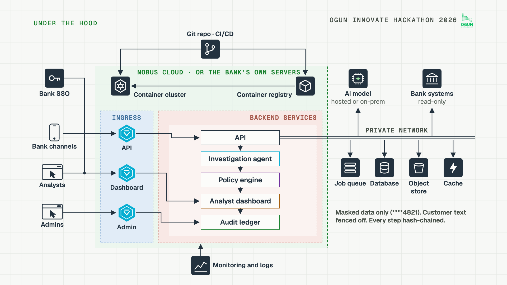
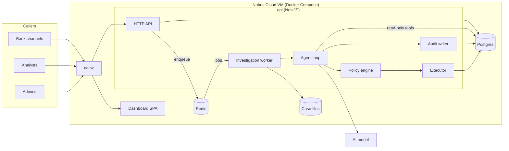

# Architecture

How resolve is put together and how it runs on Nobus Cloud. For what the product does and why, see [RESOLVE.md](RESOLVE.md).

The diagram shows the production layout. At the hackathon the same components run as a few containers on one Nobus VM; the table in [Deployment](#deployment) maps one to the other.

---

## Components

| Component                | Responsibility                                                                                                                                                                                                         |
| ------------------------ | ---------------------------------------------------------------------------------------------------------------------------------------------------------------------------------------------------------------------- |
| **HTTP API**             | NestJS controllers under `/api/v1`. Request and response DTOs are validated and described with Swagger decorators, which produce the OpenAPI document.                                                                 |
| **Investigation worker** | A BullMQ processor. Takes queued disputes, runs the agent, applies policy, calls the executor, writes the case file. Retries with backoff; repeat failures are kept as failed jobs and the dispute is marked `failed`. |
| **Agent loop**           | Bounded tool-calling loop over an OpenAI-compatible model. Owns the prompt, the tool registry and decision validation.                                                                                                 |
| **Policy engine**        | Pure function from decision and config to disposition and reasons. No I/O, no model.                                                                                                                                   |
| **Executor**             | The only code that changes money. One Postgres transaction, idempotent.                                                                                                                                                |
| **Audit writer**         | Appends hash-chained steps and verifies chains.                                                                                                                                                                        |
| **Dashboard**            | React single-page app, built to static files and served by nginx.                                                                                                                                                      |
| **Postgres**             | Disputes, investigations, steps, analyst actions, staff, config, and the synthetic bank.                                                                                                                               |
| **Redis**                | The job queue (BullMQ) and the config cache.                                                                                                                                                                           |
| **Case files**           | One JSON snapshot per dispute, rewritten on each resolution. A Docker volume at the hackathon; S3-compatible storage in production.                                                                                    |

## Stack

| Layer    | Choice                                                                                                 |
| -------- | ------------------------------------------------------------------------------------------------------ |
| Language | TypeScript, strict, end to end                                                                         |
| API      | NestJS on Node.js 24, `class-validator` DTOs, `@nestjs/swagger` for the OpenAPI document               |
| Data     | PostgreSQL 17 through Prisma, versioned migrations                                                     |
| Queue    | BullMQ on Redis (`@nestjs/bullmq`): retries with exponential backoff, failed jobs kept for retry       |
| Cache    | Redis, for config, invalidated on write                                                                |
| AI       | One OpenAI-compatible adapter; profiles for hosted and on-premise models; model output parsed with Zod |
| Web      | React Router (SPA mode), TanStack Query and Table, Tailwind CSS v4, API hooks generated with Orval     |
| Tooling  | pnpm workspaces, Turborepo, Vitest everywhere, ESLint, Prettier                                        |
| Runtime  | Docker Compose on a Nobus Cloud VM: `api`, `postgres`, `redis`, with nginx in front                    |
| CI/CD    | GitHub Actions: deploy over SSH on every push to `main`                                                |

## API contract

- Base path `/api/v1`. Interactive docs at `/api/v1/docs`; the OpenAPI document at `/api/v1/openapi.json` and committed as `apps/api/openapi.json`.
- Success: `{ "success": true, "data": …, "meta": { "requestId", "timestamp" } }`. Paged lists put `page`, `pageSize` and `total` in `meta`.
- Failure: `{ "success": false, "error": { "code", "message", "fieldErrors"?, "details"? }, "meta": { "requestId", "timestamp" } }`. Codes: `validation_error`, `unauthorized`, `forbidden`, `not_found`, `conflict`, `invalid_state`, `rate_limited`, `not_implemented`, `service_unavailable`, `internal_error`.
- Every request gets an `x-request-id` (the caller's, if valid, or a generated one), returned in the header and in `meta`.
- `packages/api-client` is generated from the OpenAPI document by Orval: typed fetch functions and TanStack Query hooks that throw `ApiError` built from the failure envelope.

## Request flow

1. A channel calls `POST /api/v1/disputes`. The controller validates the DTO; the service checks the transaction exists and has no open dispute, inserts the dispute as `queued`, and adds a job to the `investigations` queue with the dispute ID as the job ID, so the same dispute can't be queued twice.
2. The worker picks up the job, sets the dispute to `investigating`, and creates an investigation attempt recording the model profile.
3. The agent loop sends the system prompt and the dispute (customer notes inside `<untrusted>` tags) to the model. Each tool call is validated, run against Postgres, masked, truncated to 4 KB, written as an audit step, and returned to the model with its step ID.
4. The model calls `submit_decision`. The payload is parsed with Zod (one repair attempt), then the evidence validator checks each cited step.
5. The policy engine returns `auto_resolve` or `needs_review` with reasons.
6. On `auto_resolve`, the executor writes the reversal or refund and finalises the dispute in one transaction. Otherwise the dispute moves to `awaiting_review`.
7. The worker writes the case file and completes the job.
8. The dashboard polls the trace endpoint with an `after_seq` cursor, about every 1.5 seconds, while the investigation runs.

## Reliability

| Concern                        | Approach                                                                                                                                                                  |
| ------------------------------ | ------------------------------------------------------------------------------------------------------------------------------------------------------------------------- |
| Model timeouts and rate limits | 60 s timeout, retries with exponential backoff on 429, 5xx and network errors                                                                                             |
| Worker failures                | Job retried up to 3 times with exponential backoff; after that the dispute becomes `failed` and an analyst can retry it                                                   |
| Duplicate delivery             | Effects are idempotent: job ID is the dispute ID, the worker skips disputes past `investigating`, one open dispute per transaction, the executor skips existing reversals |
| Partial writes                 | Executor writes ledger, transaction and dispute in one Postgres transaction                                                                                               |
| Concurrent analyst actions     | State transitions are checked inside a transaction with a row lock; invalid ones return 409                                                                               |
| Restarts                       | Jobs live in Redis with append-only persistence on a volume; Postgres on its own volume                                                                                   |

## Security

| Threat                                           | Control                                                                                        |
| ------------------------------------------------ | ---------------------------------------------------------------------------------------------- |
| Prompt injection in customer notes               | Wrapped in `<untrusted>`; the prompt says it is data, never instructions                       |
| Injection through merchant or counterparty names | Wrapped in `<untrusted>` inside the tool layer                                                 |
| Tool abuse                                       | Fixed tool set, validated parameters, Prisma queries only, no free-text queries from the model |
| Hallucinated evidence                            | Evidence validator checks every cited step                                                     |
| The model pushing a payout                       | Disposition comes only from the policy engine, which reads typed fields                        |
| Data exposure                                    | Masked fields, opaque IDs, 4 KB output cap; on-premise model profile for full residency        |
| Logs                                             | Prompts, tool outputs and customer notes are never logged                                      |
| Stored XSS                                       | Customer text rendered as escaped text only                                                    |
| Authorisation                                    | Guards check roles on the server on every route                                                |
| Network                                          | Postgres and Redis are on the internal Docker network only, never published on the host        |

## Data model

| Table                                                                                | Purpose                                                                    |
| ------------------------------------------------------------------------------------ | -------------------------------------------------------------------------- |
| `customers`, `merchants`, `devices`, `transactions`, `ledger_entries`, `settlements` | The synthetic bank the tools read                                          |
| `disputes`                                                                           | One per complaint; status, amount (kobo, `bigint`), deadline, resolution   |
| `investigations`                                                                     | One per agent attempt; model, decision, policy result, token usage, timing |
| `agent_steps`                                                                        | Append-only, hash-chained model and tool steps                             |
| `analyst_actions`                                                                    | Append-only analyst decisions                                              |
| `staff`, `access_events`                                                             | Who can sign in, their role, and every access change                       |
| `config`                                                                             | Policy and AI settings                                                     |
| `demo_cases`                                                                         | Seeded cases with expected outcomes for evaluation                         |

A partial unique index on `disputes(transaction_id)` where the status is open enforces one open dispute per transaction. The app's database role has no `UPDATE` or `DELETE` on the audit tables.

## Deployment

| Production layout (diagram)     | Hackathon deployment                                                    |
| ------------------------------- | ----------------------------------------------------------------------- |
| Git repo, CI/CD                 | GitHub Actions on push to `main`, SSH into the VM                       |
| Container registry and cluster  | Docker Compose on one Nobus VM                                          |
| Ingress (API, Dashboard, Admin) | Host nginx on 80 and 443 → `web` container (dashboard and `/api` proxy) |
| Bank SSO                        | Simple sign-in for the demo                                             |
| Backend services                | The `api` container (HTTP and worker)                                   |
| Job queue, cache                | `redis` container                                                       |
| Database                        | `postgres` container                                                    |
| Object store                    | Docker volume for case files                                            |
| AI model                        | Configured profile                                                      |
| Monitoring and logs             | Structured JSON logs and `/api/v1/metrics`                              |

### The VM

- Ubuntu 26.04, 8 vCPU, 16 GB RAM, 50 GB disk, Nobus Cloud `nobus-wa-az1`
- Docker and Docker Compose
- `ufw`: 22 (rate-limited), 80, 443
- Host nginx terminates HTTP and HTTPS and proxies to the `web` container on `127.0.0.1:5175`
- The `web` container (nginx) serves the built dashboard and proxies `/api` to the `api` container on port 9000, with response buffering off so the live trace streams
- The API is also reachable on `127.0.0.1:9000` on the VM for health checks. Postgres and Redis are not published at all
- HTTPS through Let's Encrypt once a domain points at the VM

### Deploy flow

1. Push to `main`.
2. GitHub Actions connects to the VM over SSH using repository secrets.
3. The workflow copies the checked-out source to `~/resolve` on the VM with `rsync` (the VM's `.env` is left untouched), then runs `docker compose up -d --build` there.
4. It polls `http://127.0.0.1:9000/api/v1/health` on the VM for up to two minutes and fails the run, printing the API logs, if the stack doesn't report healthy.

The workflow needs three repository secrets: `VM_HOST`, `VM_USER` and `VM_SSH_KEY`, and a `production` environment.

Secrets (database password, model keys) live in an env file on the VM, never in the repository.
